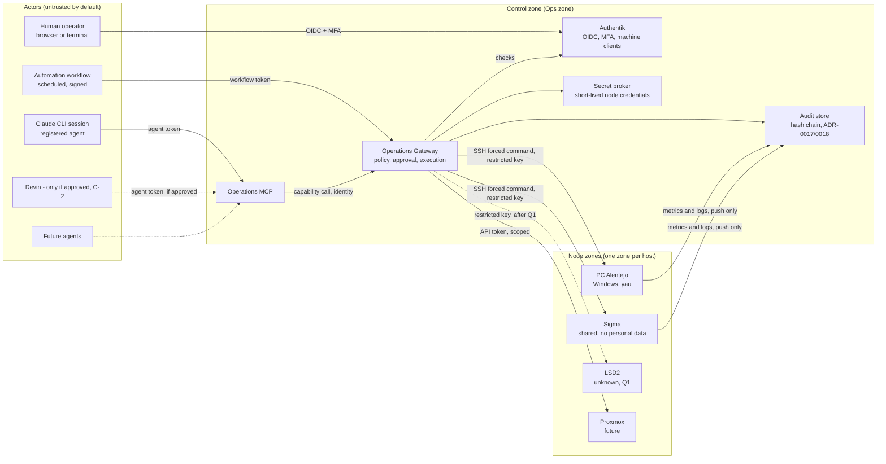

# Machine-to-Machine Communication Architecture

**Owner:** Rui Silva (`9dot5`) · **Status:** Proposed · **Review by:** 2027-04-25
**Related:** [ADR-0004](../adr/ADR-0004-zero-trust.md), [ADR-0010](../adr/ADR-0010-human-in-the-loop.md), [ADR-0011](../adr/ADR-0011-agent-architecture.md), [ADR-0012](../adr/ADR-0012-identity-provider.md), [ADR-0013](../adr/ADR-0013-reverse-proxy.md), [ADR-0016](../adr/ADR-0016-automation-engine.md), [ADR-0017](../adr/ADR-0017-agent-audit-logging.md), [ADR-0018](../adr/ADR-0018-agent-audit-backend.md), [MCP_STRATEGY.md](MCP_STRATEGY.md), [CONTEXT.md](CONTEXT.md), [BACKLOG.md](../BACKLOG.md)

This document is a design proposal. It implements nothing. Every decision here becomes binding only through the ADRs listed in §11, and only when the owner accepts them.

## 1. Facts and assumptions

Facts from the repository and the owner's environment, as of 2026-10-25:

| Node | What the repository and session show | Confirmed |
|---|---|---|
| **PC Alentejo** | Windows host `DESKTOP-Q3GOUP4`, user `yau`. Reached by SSH over the private overlay and over a public port forward, both resolving to the same host. The addresses are Internal data (ADR-0031) and are kept in the access register, not in this repository. Has Git, Python 3.11 and Claude Code | Yes, reached by SSH on 2026-10-25 |
| **Sigma** | `sigma04.ist.utl.pt`, a university shared server. ADR-0015 rejected it for the portal. THREAT_MODEL T-08 forbids personal or secret data on shared hosts. A key `id_sigma` exists locally | Host identity yes; access rights and owner unconfirmed |
| **LSD2** | Named in the request. Not in SERVICE_CATALOG, SYSTEM_LANDSCAPE or any document | **No** |
| **Legion-9dot5** | This PC. Development host (SYSTEM_LANDSCAPE: laptop, 8 GB, not production) | Yes |
| **Proxmox** | Preferred technology. Not in any inventory | No |

Assumptions (mark each as an assumption until verified):

- A1. Sigma is shared with other users. Services on it must hold no personal or secret data (T-08).
- A2. The Tailscale-range addresses (`100.x`) are a private overlay network. Their use is **not documented** in any ADR. See §8 and item D-3.
- A3. The owner is the only human operator (sole-owner mode, CONTRIBUTING).

## 2. Requirement conflicts (owner decision needed)

The request contains four points that conflict with accepted or proposed governance. This design does not resolve them. It states the consequence of each option.

| # | Request | Conflicts with | Options |
|---|---|---|---|
| C-1 | Preferred technology **n8n** | ADR-0016 rejected n8n: Sustainable Use licence, not OSI-approved, needs an ADR-0006 exception | (a) Keep ADR-0016 (scripts in Git) and do not use n8n. (b) Record an ADR-0006 exception and supersede ADR-0016 |
| C-2 | **Devin** as an actor | ADR-0011: Devin is not in use. The Claude Code `executor` replaces it | Remove Devin from the actor list, or write a new ADR that adds it with its own identity and limits |
| C-3 | **Multi-tenant** environments | PROJECT_CHARTER §3: hosting for other organisations is out of scope | Keep multi-tenant as a design-compatibility goal only (§10). Any real multi-tenant use needs a charter change |
| C-4 | **Direct** SSH from agents is forbidden, but this session already connected by SSH to PC Alentejo and copied the repository there | Requirement 1 and ADR-0017 (agents run under a registered identity, every action recorded). The owner-session actions were not recorded, see R-01 | Record the 2026-10-25 connection in the risk register and in ADR-0017. Do not repeat it until the gateway exists |
| C-5 | **Sigma as the monitoring centre** (owner, 2026-10-25). Sigma is a university shared host (T-08). The owner has no root there, so nothing can be installed with system rights | T-08: no personal or secret data on shared hosts. ADR-0015 rejected Sigma for the portal. ADR-0018 keeps the audit record outside the agent hosts and under owner control. A university admin can read anything on Sigma | (a) Sigma holds health and metrics only, pushed by the nodes. Audit records and secrets stay on owner-controlled storage. (b) Sigma holds the audit record too, and the owner accepts that as a recorded exception under T-08. Recommendation: (a) |
| C-6 | **Sigma as a bridge (jump host) to the CSHP lab PCs**, which are more machines and may be reachable from Sigma. Each lab PC is outside the owner's control and "not ours to load" (ADR-0007) | TB-4 denies node-to-node traffic by default. Each lab PC would also be a new node with no owner, no inventory and no approval. ADR-0031 Part C must allow the hop explicitly | Allow hops only per named host, after a recorded ADR-0031 Part C decision, with a per-host entry in the node registry (disabled until approved). Recommendation: no automatic discovery of lab machines. Each one is added by hand |

## 3. Architecture overview

Principle: **no actor connects to a node directly.** Humans, Claude CLI sessions, Devin (if approved), MCP servers, workflows and future agents reach nodes only through one **Operations Layer**. The layer has three parts:

- **Operations Gateway (OG)**: the only component that holds node credentials. It validates identity, checks policy, asks for approval when required, runs the action, and writes the audit record.
- **Operations MCP (OPS-MCP)**: the typed interface agents use. It exposes named capabilities and never a shell.
- **Node Adapters**: small, separate executors inside the gateway, one per node type (SSH host, Proxmox API, container runtime, metrics store). Each adapter runs only the commands it is built for.

## 4. Authentication and authorisation model

### 4.1 Identities

| Identity type | Example | Authenticates with | Lifetime | Stored by |
|---|---|---|---|---|
| Human | Rui Silva (`9dot5`) | Authentik OIDC, phishing-resistant MFA (passkey or hardware key) | Session, re-auth for approvals | Authentik |
| Agent | `architect`, `executor`, `docs-maintainer` (ADR-0017) | Per-agent machine client in Authentik, client credentials, token bound to the registered `AGENT_ID` | 1 hour, renewed per session | Authentik; signing key in the local key store (ADR-0017) |
| MCP server | `ops-mcp` | Machine client, mutual TLS between MCP and OG | 1 hour | Authentik |
| Workflow | `backup-verify`, `health-report` | Workflow identity bound to a Git commit SHA of the workflow definition | Per run | Authentik |
| Node | `alentejo-adapter`, `sigma-adapter` | SSH key held by OG only, in restricted account, forced command | Rotated yearly (AGENT_IDENTITIES rule 4) | Secret broker |

### 4.2 Authorisation

- **Default deny.** An identity can call a capability only when its policy lists that capability, for that node, at that tier (§6).
- **Scope per call.** Every request carries: actor (human sub), agent or workflow id, MCP client id, node, capability, arguments hash, and a run id. OG rejects requests that lack any of them.
- **Tier-based.** Read calls run directly. Write calls need an approval record (§5). Manual calls are not executed by the system at all: OG only generates the procedure and the owner runs it.
- **No self-approval.** No identity can approve a request it made. Under sole-owner mode, approval is the owner's act, performed through Authentik with MFA, bound to one request hash and a time limit.

### 4.3 Secrets

- Node credentials exist only in the secret broker and are injected into OG for one call. Agents and MCP servers never see them (SECRET_MANAGEMENT rule 5, ADR-0014).
- SSH keys for nodes use a restricted account per node with a forced command. The key in `authorized_keys` is prefixed with `restrict,command="<adapter>"` so a stolen key cannot open a shell.

## 5. Operations MCP design

OPS-MCP exposes typed tools only. Each tool maps to one adapter operation. There is no generic shell tool (MCP_STRATEGY rule 1).

| Tool | Tier | Parameters (typed, bounded) | Returns | Notes |
|---|---|---|---|---|
| `get_system_status` | Read | node | Uptime, OS, load, versions | Node list is an enum from SERVICE_CATALOG |
| `get_health` | Read | node, service? | Up or down, last check time | Feeds MONITORING_STRATEGY |
| `get_proxmox_inventory` | Read | none | VM and container list, state | Proxmox adapter, future |
| `get_storage_status` | Read | node | Volumes, free space, percent used | No file listing |
| `get_gpu_status` | Read | node | GPU model, memory used, temperature | Read-only query tool |
| `get_running_services` | Read | node | Service name, state, port (bound interface) | Port list filtered to documented services |
| `query_logs` | Read | node, service, time window, max lines (cap 500) | Redacted log lines | Redaction before return (ADR-0009 rule 5) |
| `query_metrics` | Read | node, metric enum, window | Series | Metric names are an allow-list |
| `restart_service` | Write + approval | node, service (enum) | Result, old and new state | Reversible. Approval required (§6) |
| `deploy_service` | Write + approval | node, service, version (digest, not tag) | Result, rollback id | Pinned digests only. Production needs approval; Sigma is manual only (§6) |

Rules for every tool:

1. Inputs are validated against a schema. Unknown fields are rejected.
2. Outputs are untrusted for the calling agent (T-03). OPS-MCP labels them as data.
3. Each call writes one audit record before execution and one after (ADR-0017), shipped to the sink before the action runs.
4. Tool descriptions are reviewed as API contracts (MCP_STRATEGY rule 5).

## 6. Permission matrix

Legend: **R** read directly · **A** write, needs approval · **M** manual, the system only prepares the procedure · **–** not allowed.

| Operation | Human owner | Claude CLI (`executor`) | Automation workflow | Devin (if approved) | Future agent |
|---|---|---|---|---|---|
| `get_system_status`, `get_health` | R | R | R | R | R |
| `get_proxmox_inventory`, `get_storage_status`, `get_gpu_status` | R | R | R | R | R |
| `get_running_services` | R | R | R | R | R |
| `query_logs` (redacted) | R | R | R | R | R on own node only |
| `query_metrics` | R | R | R | R | R |
| `restart_service` (test node) | R, approve | A | A (pre-approved per runbook) | A | – |
| `restart_service` (Alentejo) | R, approve | A | A | A | – |
| `restart_service` (Sigma) | M | – | – | – | – |
| `deploy_service` (test) | R, approve | A | A (pre-approved) | A | – |
| `deploy_service` (production) | M | – | – | – | – |
| Any change on Sigma | M | – | – | – | – |
| Restore over live data | M, with explicit confirmation (ADR-0010 rule 4) | – | – | – | – |
| Credential rotation, key changes | M | – | – | – | – |
| Change to firewall, ports or network zones | M, plus ADR | – | – | – | – |
| Access rule changes (Authentik policies) | M | – | – | – | – |

Explanation of the tiers:

- **Read** calls are logged but not gated. They expose only redacted or summarised data.
- **Write with approval** covers reversible actions. Approval is per request, bound to one hash, and expires after 15 minutes (proposed).
- **Manual** covers anything touching a shared host, production data, keys, access rules or network zones. The gateway returns a numbered procedure and a rollback step. The owner runs it and records the result.
- **Workflow pre-approval** exists only for a named runbook step, reviewed in Git, with a recorded approval of the runbook itself. It does not extend to any other step.

## 7. Node communication and trust boundaries

### 7.1 Trust boundaries

| ID | Boundary | Trust level | Controls |
|---|---|---|---|
| TB-1 | Actors to Ops zone | Untrusted to authenticated | OIDC with MFA for humans. Machine tokens for agents. Deny by default |
| TB-2 | Ops zone internal (IdP, OPS-MCP, OG, audit) | Trusted, least privilege per service | Separate service identities. OG is the only holder of node credentials |
| TB-3 | OG to nodes | Restricted | One restricted account per node. Forced command per adapter. Source IP allow-list to OG |
| TB-4 | Node to Node (Alentejo, Sigma, LSD2) | **Denied by default** | No declared flow unless added to §8 and approved |
| TB-5 | Nodes to audit and telemetry | Push only | Nodes send logs and metrics outbound. They cannot read the sink (ADR-0018 write-only tokens) |
| TB-6 | Ops zone to SaaS (GitHub, Jira, Confluence, Rovo) | Outbound, scoped | GitHub Apps per agent (GITHUB_APPS). Scoped API tokens for others |
| TB-7 | Sigma (shared) | Hostile by assumption (A1) | No personal or secret data. Manual changes only. Outbound push of metrics only, if the owner allows it |
| TB-8 | Legion (this PC) and any developer client | Untrusted | Not a node. Can reach OPS-MCP only through an approved client |

### 7.2 Network

- **Overlay.** The `100.x` addresses are the transport. Overlay membership is **never** an authorisation (ADR-0004 rule 1). Every request still passes OIDC or a machine token at OG.
- **Ingress.** Only OG and the IdP accept inbound traffic, and only through the reverse proxy (ADR-0013). Nodes accept inbound SSH only from the OG source address, and only with the restricted key.
- **Egress.** Nodes push to the sink. They have no outbound route to other nodes.

## 8. Communication flows

| Flow | From → To | Protocol | Auth | Audit record |
|---|---|---|---|---|
| F-1 Human session | Human → IdP → OG UI or API | HTTPS, OIDC | Passkey + MFA | Login, token issue |
| F-2 Agent call | Claude CLI → OPS-MCP → OG | MCP over HTTPS (mTLS) | Agent machine token bound to `AGENT_ID` | Attempt and result, with `AGENT_ID`, session id, tool name |
| F-3 Read on node | OG → node adapter → node | SSH forced command (Windows OpenSSH) or API | Restricted node key or API token | Request, arguments hash, result hash |
| F-4 Write with approval | OG → owner (approval prompt) → OG → node | HTTPS, then as F-3 | Owner MFA over the approval hash | Request, approval, execution, rollback id |
| F-5 Manual procedure | OG → owner (procedure text) → owner executes → owner records result | Ticket or Confluence page | Owner | Procedure, result, time |
| F-6 Telemetry | Node → sink | HTTPS push | Write-only sink token | Shipped records |
| F-7 Workflow | Scheduler → OG → node | As F-3 | Workflow identity, commit SHA pinned | Run id, commit SHA |
| F-8 Node to node | Alentejo ↔ Sigma ↔ LSD2 | **None declared** | – | Attempt blocked, alert (TB-4) |
| F-9 Repository and work tracking | Claude CLI → GitHub, Jira, Confluence, Rovo | HTTPS, API | GitHub App, scoped API token | Per SaaS audit log, linked by run id |

## 9. Node profiles

| Node | Role | Trust | Access by OG | Allowed services | Data allowed |
|---|---|---|---|---|---|
| **PC Alentejo** (`DESKTOP-Q3GOUP4`) | Windows workstation, user `yau` | **Owned.** The owner controls the host and the `yau` account (owner statement, 2026-10-25) | Restricted SSH key, forced command, Windows OpenSSH | Read status, health, services, logs. Restart only after approval | Internal only. No secrets, no personal data from the owner's accounts |
| **Sigma** (`sigma04.ist.utl.pt`) | Monitoring centre (owner decision, 2026-10-25). Bridge to the CSHP lab PCs. No root for the owner, so nothing is installed with system rights | Shared, not owned (T-08) | Read-only health and metrics, pushed by nodes (TB-5). No writes through OG until C-5 and C-6 are decided. Hops to lab PCs only by named entry (C-6) | User-space monitoring that needs no root. Scheduled jobs with no personal data | Health, metrics and non-personal status only (C-5 option a). Audit records and secrets stay off Sigma |
| **LSD2** | **Unknown** | **Unknown** (Q1) | Not allowed until identified | None | None |
| **Legion-9dot5** | Development | Not a production node | Not an adapter target | None | Repository only |
| **Proxmox host** (future) | Virtualisation | Owner-controlled | API token, scoped to inventory and VM lifecycle | Inventory, VM status | Internal |

Two notes:

- PC Alentejo and its user account `yau` belong to the owner (owner statement, 2026-10-25). Its ownership class under ADR-0031 Part A is `owned`. It is not yet admitted: the other admission conditions are still open.
- Sigma holds an SSH key on this PC (`id_sigma`). Under this design, that direct key use is replaced by OG. Revoke the direct path once OG exists.

## 10. Service catalogue (proposed entries)

Fields follow SERVICE_CATALOG: name, component, host, environment, owner, exposure, data class, auth, backup, monitoring, runbook, ADR.

| Service | Component | Host | Env | Exposure | Data class | Auth | ADR |
|---|---|---|---|---|---|---|---|
| Authentik | Identity provider | Control node (to measure) | Prod | Via proxy | Secret, Personal | OIDC, MFA | ADR-0012 |
| Operations Gateway | Policy, approval, execution | Control node | Prod | Internal, via proxy | Secret (brokered) | Machine token, mTLS | **ADR-0029 (proposed)** |
| Operations MCP | Typed agent interface | Control node | Prod | Internal, to registered clients | Internal | Agent token | **ADR-0029** |
| Audit store | Hash-chained log | Outside agent hosts | Prod | Internal | Internal | Write-only tokens | ADR-0017, ADR-0018 |
| Secret broker | Node credentials | Control node | Prod | Internal | Secret | Admin MFA | ADR-0014 |
| Node adapters | Per node type | Control node | Prod | Internal | Secret (in use) | Brokered | ADR-0029 |
| Proxmox | Virtualisation | Future | Prod | Internal | Internal | API token | **ADR-0035 (future)** |
| Open WebUI | Chat front-end for humans | Control node | Prod | Via proxy, human only | Internal | OIDC | **ADR-0036 (proposed)** |
| Qdrant | Vector store (Phase 05) | Control node | Prod | Internal, read by OPS-MCP knowledge tool only | Internal, restricted excluded (ADR-0008) | API key from broker | ADR-0007, ADR-0008 |
| n8n | Workflow engine | **Blocked by C-1** | – | – | – | – | ADR-0016 (conflict) |

## 11. ADR recommendations

Numbers continue from BACKLOG (ADR-0019 to ADR-0028). Numbers below are proposals. Each is Proposed until the owner accepts it.

**Renumbering (2026-10-25).** ADR-0030 to ADR-0033 were assigned to other decisions when the owner asked for them: ADR-0030 Sigma monitoring boundary, ADR-0031 node admission policy and security gate, ADR-0032 approval persistence, ADR-0033 out-of-band access policy. Read the rows below with this mapping: "Node access model" is covered by ADR-0031 Part A and the adapter ADR still to write; "Machine identity" becomes ADR-0037; "Network trust zones and overlay" becomes ADR-0034; "Portability" becomes ADR-0035; "Open WebUI" becomes ADR-0036; "n8n" becomes ADR-0038; "Devin" becomes ADR-0039. The row numbers below are kept only to show the original order.

| Proposed ADR | Decision it records | Depends on |
|---|---|---|
| **ADR-0029** Operations Layer and Operations MCP | Single Operations Gateway, typed capabilities, no shell tool, adapters per node type, tiers Read/Write-approval/Manual | ADR-0004, ADR-0010, ADR-0017 |
| **ADR-0030** Node access model | No direct agent SSH. Restricted node accounts with forced commands. Node-to-node flows denied by default. Sigma manual-only | ADR-0004, ADR-0006, ADR-0029, T-08 |
| **ADR-0031** Machine identity and attribution | Authentik machine clients per agent and per workflow. Attribution fields (human, agent, MCP, workflow, run). Approval binding to request hash | ADR-0012, ADR-0017 |
| **ADR-0032** Network trust zones and overlay | Overlay (`100.x`) is transport only. Zone map. Default deny between nodes. Proxy rules | ADR-0004, ADR-0013, ADR-0021 (overlay provider as a proprietary or hosted service, to be assessed) |
| **ADR-0033** Portability and future node types | Adapter contract for Kubernetes, cloud and Proxmox. Tenant field reserved, not active. Cloud-agnostic test | ADR-0001, ADR-0006, PROJECT_CHARTER §3 (C-3) |
| **ADR-0034** Human chat front-end (Open WebUI) | Permitted use, data classes, which tools it can reach (read-only OPS-MCP) | ADR-0007, ADR-0010 |
| **ADR-0016 amendment or ADR-0035** Automation engine and n8n | Resolves C-1 | ADR-0006, ADR-0016 |
| **ADR-0036** Devin status | Resolves C-2 | ADR-0011 |

Also required, not as ADRs: update `architecture/MCP_STRATEGY.md` (OPS-MCP is the operations server in the table), update `architecture/CONTEXT.md` boundaries, and record the 2026-10-25 SSH connection as a risk (R-01 extension) and as a fact in ADR-0017.

## 12. Future compatibility

- **Kubernetes.** A new Node Adapter (`k8s-api`) with the same capability names. The permission matrix does not change. Pods do not get node credentials.
- **Cloud and hybrid.** Adapters are per node type, not per provider (ADR-0001 rule 3). Cloud identity is a federated identity behind Authentik, not a second IdP.
- **Multiple clients.** Each client is a registered machine client with its own policy. No client gets a capability its policy does not list.
- **Multi-tenant.** A `tenant` field is reserved in every request and audit record now, and set to `owner` only. Activating more tenants needs a charter change (C-3) and its own ADR.

## 13. Open questions for the owner

1. **LSD2**: what is it, who runs it, and is it ours? Until answered, it is excluded.
2. **Sigma**: may the platform push metrics from Sigma, or is Sigma manual-only?
3. **Overlay (`100.x`)**: which product provides it, and does it hold the owner's keys? It needs its own ADR (ADR-0034).
4. **PC Alentejo**: answered 2026-10-25. The host and the `yau` account are the owner's (ownership class `owned`).
5. **C-1 to C-4**: decide the four conflicts in §2.
6. **Approval channel**: is approval through Authentik acceptable as the owner's out-of-band step, or do you want a second channel (for example a phone prompt)?

## 14. Change history

| Date | Change | By |
|---|---|---|
| 2026-10-25 | First version, architecture proposal | Architect role (draft for owner review) |
