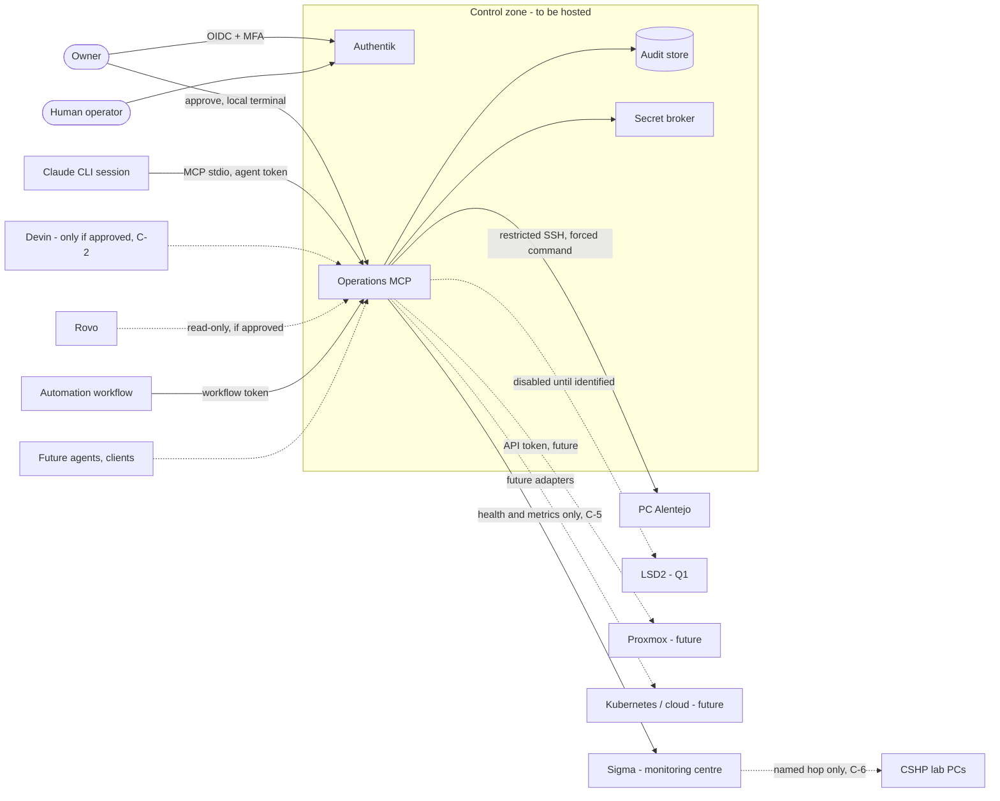
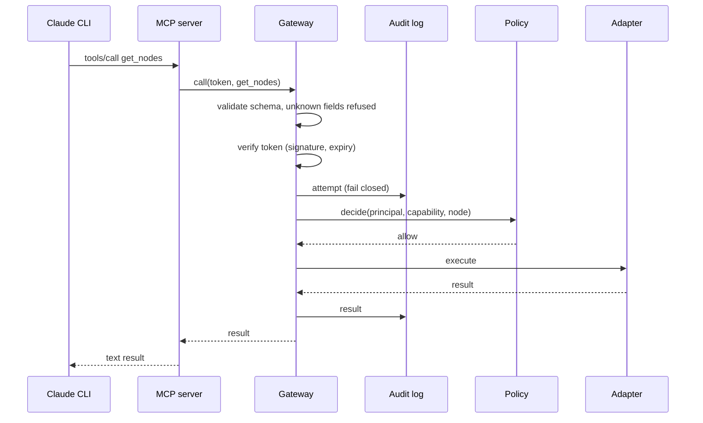
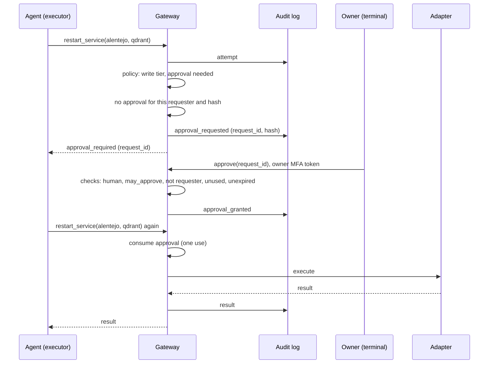

# Operations MCP: System Architecture (Phase 1)

**Owner:** Rui Silva (`9dot5`) · **Status:** Proposed · **Review by:** 2027-01-25
**Related:** [ADR-0029](../adr/ADR-0029-operations-mcp.md), [M2M_ARCHITECTURE.md](M2M_ARCHITECTURE.md), [MCP_STRATEGY.md](MCP_STRATEGY.md), [security/OPS_MCP_THREAT_MODEL.md](../security/OPS_MCP_THREAT_MODEL.md)

Phase 1 deliverables: system context, components, sequences, permissions, trust boundaries and risks. The permission matrix and the trust-boundary table are maintained in [M2M_ARCHITECTURE.md](M2M_ARCHITECTURE.md) §6 and §7 and are not repeated here. Risks are in [RISK_REGISTER.md](../RISK_REGISTER.md) (R-22 to R-26 added below).

## 1. System context

Version 0.1 contains only the MCP server, the gateway and the adapters that need no network. The arrows to nodes are the target design, not code.

## 2. Components

| Component | Responsibility | Module | State in 0.1 |
|---|---|---|---|
| MCP server | Protocol surface. Reads one token per process | `server.py` | Implemented |
| Gateway | Single path for all calls. Orders the checks | `gateway.py` | Implemented |
| Capability registry | Public names, tiers, schemas | `capabilities.py` | Implemented, 21 capabilities |
| Token verifier | Authentication | `identity.py` | Development verifier. Authentik is the target (ADR-0012) |
| Policy engine | RBAC, node scope, manual-only | `policy.py` | Implemented |
| Approval engine | One-time, bound, expiring approvals | `approval.py` | Implemented, in memory |
| Audit log | Hash chain, fail closed | `audit.py` | Implemented, local file. Sink to ADR-0018 later |
| Adapters | Execute against a node or a source | `adapters/` | Not-configured, node registry, ADR search |
| Secret broker | Node credentials, short-lived | ADR-0014 | Not present |

## 3. Sequence: read call

## 4. Sequence: write call with approval

## 5. Sequence: refusal

Refusals (bad token, unknown capability, unknown argument, disabled node, manual-only node, role not granted) write an audit record and return an error. No adapter is called. The refusal reason is recorded so that repeated refusals can be reviewed.

## 6. Sigma as monitoring centre

Decided by the owner on 2026-10-25. Sigma is a shared university host, so its role is limited:

- It receives health and metrics pushed by nodes (TB-5). It is not where audit records or secrets are stored (C-5, recommendation a).
- It is not a write target. Writes to Sigma are refused (`manual_only`).
- A hop from Sigma to a CSHP lab PC is a separate, named, disabled-by-default entry in the node registry, after ADR-0031 Part C admits that host (C-6). Discovery of lab machines is not automatic.

## 7. Trust boundaries

Defined in [M2M_ARCHITECTURE.md](M2M_ARCHITECTURE.md) §7 (TB-1 to TB-8). The boundaries relevant to version 0.1 are TB-1 (actor to gateway) and TB-2 (inside the control zone). Everything beyond the gateway is not yet connected.

## 8. New risks (added to RISK_REGISTER)

| ID | Risk | L | I | Score | Treatment |
|---|---|---|---|---|---|
| R-22 | Approval is recorded after state change; a failed audit write leaves an approval without a record | 2 | 4 | 8 | Reduce. Reverse the order before activation |
| R-23 | Approvals and audit cursor are in memory; a restart loses pending approvals | 3 | 2 | 6 | Reduce. Persist in Phase 03 |
| R-24 | Sigma (shared) holds monitoring data about the owner's nodes | 3 | 3 | 9 | Reduce. Health and metrics only (C-5) |
| R-25 | Hops from Sigma to lab PCs widen the attack path to machines with no owner | 3 | 4 | 12 | Avoid until ADR-0031 Part C. Named entries only (C-6) |
| R-26 | Shared HMAC key for tokens in development use | 2 | 4 | 8 | Reduce. Authentik before any real node |
