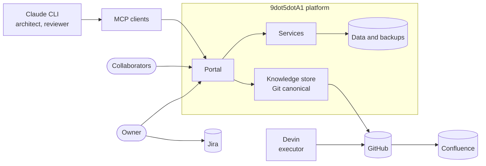

# System context diagram

Source for [architecture/CONTEXT.md](../../architecture/CONTEXT.md). Mermaid; render in GitHub or Confluence.

Legend: solid arrows are requests. Trust boundaries are described in CONTEXT.md.
Date: 2026-10-24.
